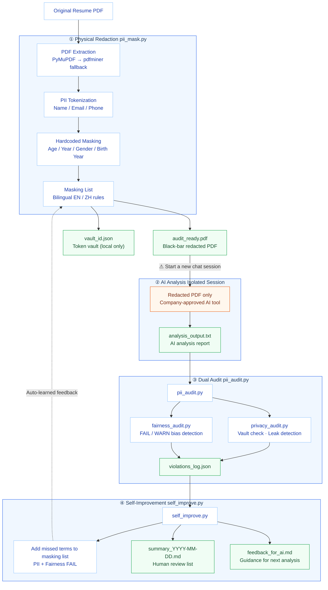

# AnonyHire

**AI-Driven Privacy & Equity Shield for Recruitment**

[繁體中文](README.md) | English

AnonyHire is a Claude Code skill that puts a privacy and fairness gate in front of AI resume screening. Before any AI model sees a resume, AnonyHire **physically redacts** personal and demographic data from the PDF. After the AI produces its analysis, AnonyHire **audits the output** for privacy leaks and biased language — and learns from every miss.

The goal is simple: let AI help you evaluate skills and experience, without ever giving it the chance to judge a candidate by name, age, gender, or background.

> [!NOTE]
> **Why it matters**
> Regulations such as the EU AI Act classify AI used in recruitment as **high-risk**. Employers increasingly need to show that protected characteristics (age, gender, ethnicity, and more) are kept out of AI-assisted hiring decisions — both to reduce legal exposure and to meet ESG and DEI commitments.

---

## How It Works



**Why a new chat session for Step 2?** The original resume and the token vault must never share a context window with the AI doing the evaluation. Running the analysis in a fresh session guarantees the model only ever sees the redacted PDF.

---

## Compliance & Ethical Foundation

AnonyHire's rules are designed with reference to the following standards:

### 🌐 International
- **EU AI Act** — Transparency and bias-audit expectations for high-risk AI systems, including recruitment.
- **EEOC (United States)** — Preventing *adverse impact* on protected groups (e.g., the four-fifths rule) under Title VII.
- **NYC Local Law 144** — The spirit of annual bias audits for Automated Employment Decision Tools (AEDT).
- **GDPR** — Data minimization: personal data is removed before it reaches the AI.

### 🇹🇼 Taiwan
- **Personal Data Protection Act** — Personal data is physically redacted before AI processing.
- **Employment Service Act, Article 5** — AI reports are audited against the 18 protected categories of employment discrimination.
- **Gender Equality in Employment Act** — Proxy signals such as parental or maternity leave are masked.

---

## Key Features

### 1. Robust PDF Extraction
- Uses **PyMuPDF** first and automatically falls back to **pdfminer.six** when CID-font garbling is detected.
- Handles resumes exported from job boards and other CID-font PDFs.

### 2. Hardcoded Demographic Masking
Enforced in code, independent of any rule file — these are *always* masked:
- Age (`36 years old` → `[AGE_REDACTED]`)
- Gender (`Male` / `Female` next to age → `[GENDER_REDACTED]`)
- Birth year, including Taiwan's ROC calendar format (→ `[BIRTHYEAR_REDACTED]`)
- Date of birth (→ `[BIRTHDATE_REDACTED]`)

### 3. Year Sealing
Every four-digit year from 1900–2099 is replaced with `[YEAR_REDACTED]`, so age cannot be inferred from graduation or employment dates.

### 4. Physical PDF Redaction
Uses `fitz.add_redact_annot` to burn black bars over names, phone numbers, addresses, emails, ages, and years. The underlying text is removed — not just covered — so it cannot be recovered by selecting text or running OCR.

### 5. Name Detection
- Pass `--name`, `--ename`, and `--cname` to mask specific names explicitly.
- When no Chinese name is supplied, `detect_chinese_name.py` detects it automatically from the PDF text.

### 6. Dual Audit Agents
- **Privacy Audit** — Compares the AI report against the local vault to catch any leaked personal data.
- **Fairness Audit** — Scans the AI report for biased language in two tiers:
  - `FAIL` — Direct reference to a protected attribute. The analysis must be redone.
  - `WARN` — Proxy indicators or potentially biased wording. Needs human confirmation.

### 7. Self-Improving Masking Rules
Anything the audit catches is fed back into the masking list automatically, so the same leak doesn't happen twice.

### 8. Ethical Screening Certificate & Daily Summary
- Each candidate gets a `CERTIFICATE.md` recording both audit results.
- Each batch produces one `summary_YYYY-MM-DD.md` that clearly splits candidates into **needs human review** (privacy leak / fairness concern / audit error) and **all clear**.

---

## Installation

### 1. Clone into your Claude Code skills folder
```bash
git clone https://github.com/chengwesley/AnonyHire.git ~/.claude/skills/ethical-resume-screen
```

Claude Code picks up skills from `~/.claude/skills/` automatically. Once installed, the privacy gate activates whenever a conversation involves resumes, candidates, or screening.

### 2. Install Python dependencies
Requires Python 3 with `PyMuPDF` and `pdfminer.six`:
```bash
pip install -r ~/.claude/skills/ethical-resume-screen/requirements.txt
```

---

## Quick Start

You can ask Claude Code to run the workflow for you, or run each step yourself from the skill folder.

### Batch mode
Put the resume PDFs in `real/`, then run:
```bash
python scripts/pii_mask.py --batch real/
```

### Single resume (standard flow)

**Step 1 — Physical redaction**
```bash
python scripts/pii_mask.py --pdf real/resume.pdf --name "Jane Doe" --ename "Jane"
```
Output:
- `masked/audit_ready_resume.pdf` — Black-bar redacted PDF
- `masked/vault_resume.json` — Token mapping. **Keep it local. Never share it.**

**Step 2 — AI analysis (in a new chat session)**

Give only `masked/audit_ready_resume.pdf` to your company-approved AI screening tool, and save its output as a text file.

**Step 3 — Audit**
```bash
python scripts/pii_audit.py <candidate_id> <analysis_output.txt> --tool "<your screening tool>"
```
Output:
- `reports/violations_log.json` — Cumulative audit log
- `reports/projects/<PID>/<CID>/CERTIFICATE.md` — Ethical Screening Certificate (privacy + fairness)
- `reports/projects/<PID>/<CID>/analysis_original.txt` — Archived copy of the original AI report

**Step 4 — Summary & self-improvement**
```bash
python scripts/self_improve.py
```
Output:
- `reports/summary_YYYY-MM-DD.md` — Daily governance summary with the human review list
- `reports/feedback_for_ai.md` — Guidance to strengthen the next AI analysis

---

## Redaction Reference

| Category | Example | Token |
|----------|---------|-------|
| Name | Jane Doe | `[CANDIDATE_001]` |
| Email | abc@gmail.com | `[EMAIL_002]` |
| Phone | +1 555-123-4567 | `[PII_003]` |
| Year | 2019, 1995 | `[YEAR_REDACTED]` |
| Age | 36 years old | `[AGE_REDACTED]` |
| Gender | Male / Female | `[GENDER_REDACTED]` |
| Birth year | ROC year 75 (= 1986) | `[BIRTHYEAR_REDACTED]` |
| Date of birth | 1990/01/01 | `[BIRTHDATE_REDACTED]` |
| Sensitive keywords | Parental leave, ADHD | `[SENSITIVE_XXX]` |

---

## Project Structure

```
scripts/
  pii_mask.py             # Redaction engine (PDF extraction + tokenization + black bars)
  pii_audit.py            # Audit coordinator (runs Privacy + Fairness agents)
  self_improve.py         # Self-improvement + daily summary
  privacy_audit.py        # Privacy agent (vault comparison)
  fairness_audit.py       # Fairness agent (bias keyword detection)
  detect_chinese_name.py  # Chinese name auto-detection
rules/
  masking_rules.md        # Bilingual masking rules (regex + masking list + auto-learned)
  fairness_principles.md  # Fairness principles and regulatory references
masked/                   # Redacted PDFs + vault JSON (local only)
reports/
  violations_log.json          # All audit results (cumulative)
  summary_YYYY-MM-DD.md        # Daily summary
  feedback_for_ai.md           # Guidance for the next AI analysis
  projects/
    <PID>/
      <CID>/
        CERTIFICATE.md         # Ethical Screening Certificate
        analysis_original.txt  # Archived original AI report
real/                     # Input folder for original resume PDFs
```

---

## Inclusive Design

AnonyHire's core principle: **minimize what's irrelevant, maximize what's professional.**

We redact gender (including non-binary identities), ethnicity and origin, and health conditions — not because these identities should be hidden, but to remove unconscious bias at the very first stage of screening. Every candidate's skills deserve to be seen from the same starting line.

AnonyHire is built around **DEI (Diversity, Equity, and Inclusion)** principles, and its own logic is regularly reviewed to make sure the tool itself doesn't introduce exclusion.

---

## Limitations & Disclaimer

> [!CAUTION]
> 1. **Not 100% accurate.** Semantic analysis relies on large language models, which can produce **false positives** and **false negatives**.
> 2. **Human in the loop.** AnonyHire is a supporting governance tool. Final hiring decisions and audit conclusions should always be confirmed by HR or compliance professionals — start with the "needs human review" list in the daily summary.
> 3. **Keep rules current.** Biased language and legal standards evolve. Review the files in `rules/` regularly.
> 4. **Not legal advice.** Using AnonyHire does not by itself make a hiring process compliant with any law. Consult your legal counsel for your jurisdiction.

---

## License

Released under the **MIT License**. You're free to use, modify, and distribute this code; please keep the original copyright and license notice. See [LICENSE](LICENSE).
